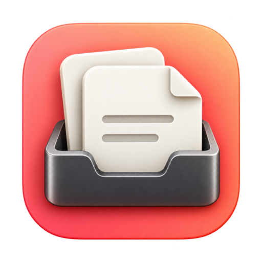
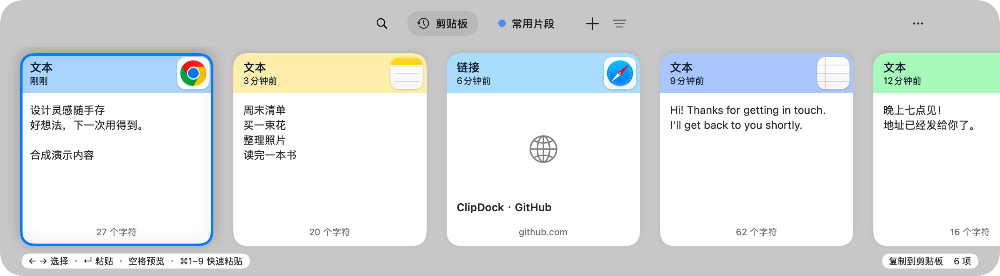
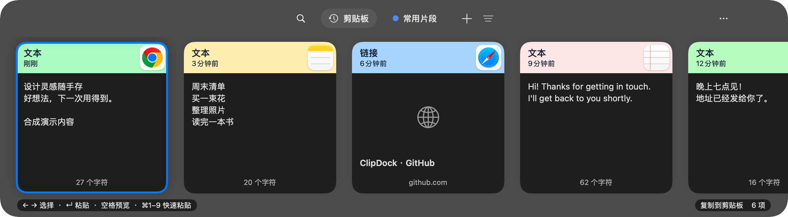
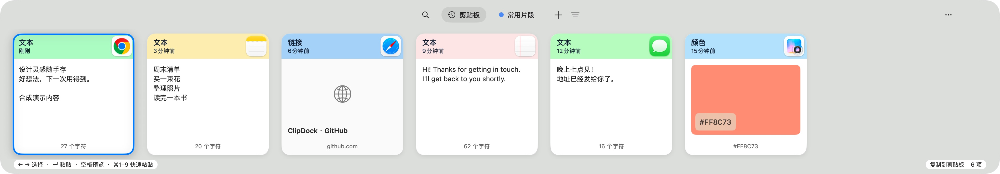
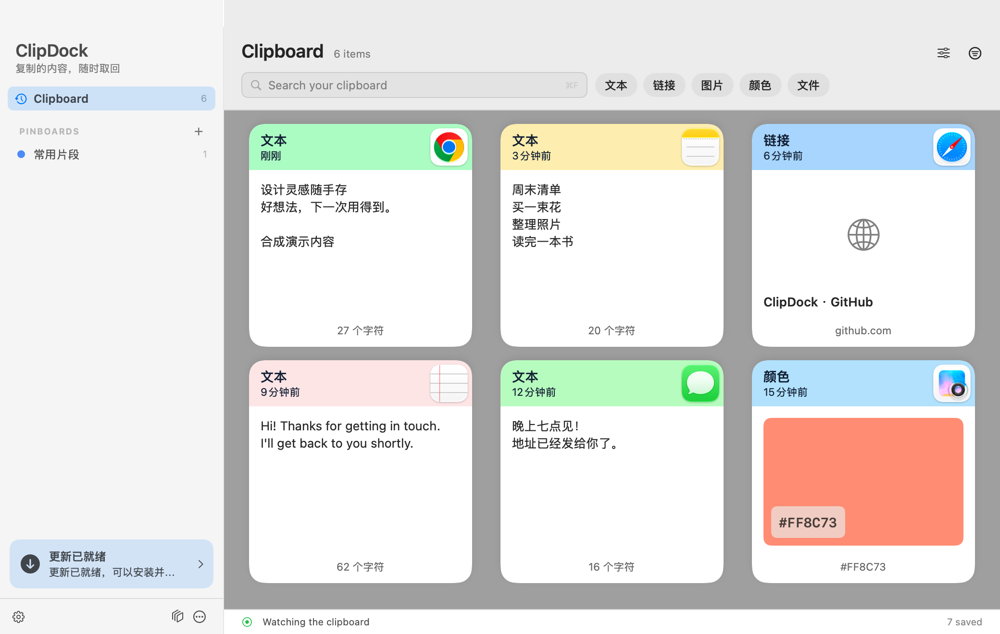
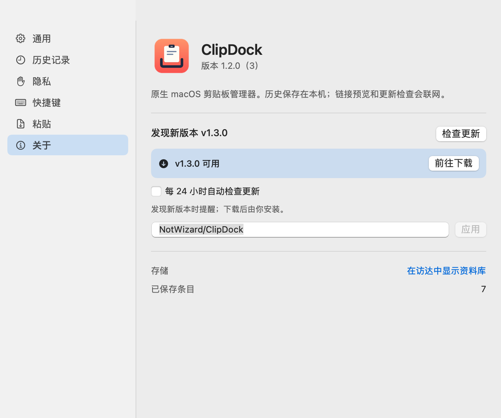
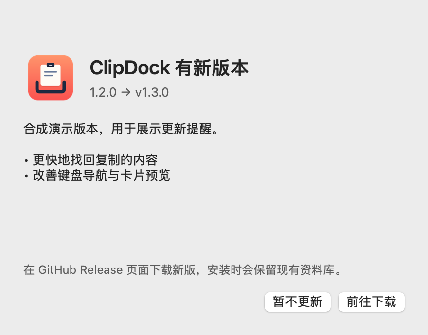

  

<h1 align="center">ClipDock</h1>

  <strong>复制的内容，随时取回。</strong> 
  从桌面底部唤起的原生 macOS 剪贴板管理器。 
  Your clipboard, within reach.

  
  
  
  
  

  <a href="https://github.com/NotWizard/ClipDock/releases/latest"><strong>下载最新版</strong></a> ·
  <a href="#快速上手">快速上手</a> ·
  <a href="#界面一览">界面一览</a> ·
  <a href="https://github.com/NotWizard/ClipDock/issues">反馈问题</a>

<picture>
  <source media="(prefers-color-scheme: dark)" srcset="docs/public/panel-dark.png">
  <source media="(prefers-color-scheme: light)" srcset="docs/public/panel-light.png">
  
</picture>

按 ⇧⌘V 打开，输入即搜索，选中后回车。展示图使用合成演示内容。

## 用 ClipDock 做什么

复制过的文字、链接和图片，不必再回到原来的应用重新找。ClipDock 把它们保存在本机，用一排能看清内容和来源的卡片呈现，需要时再取回来。

| 你想做的事 | ClipDock 的方式 |
| --- | --- |
| 找回刚才复制的内容 | 快捷键唤起底部浮层，横向浏览，直接输入搜索；也可按内容类型筛选。 |
| 看清内容再使用 | 来源 App 图标与明亮卡头帮助辨认，空格打开附属预览，文本可选择、编辑。 |
| 留住经常用的片段 | 把签名、回复模板等放进 Pinboard，或固定单个条目；它们不受历史数量限制。 |
| 处理不同类型的复制内容 | 支持文本、链接、图片、颜色和文件；提供图片文字识别、可选链接预览。 |
| 连续填写、减少整理 | 用粘贴队列依次取用条目，或按住 Shift 以纯文本提交。 |
| 按自己的习惯使用 | 自定义快捷键、暂停记录、排除指定应用；界面跟随系统浅色与深色外观。 |

## 安装

**需要 macOS 14 或更新版本，以及 Apple Silicon Mac（M 系列芯片）。** 当前提供 arm64 安装包，Intel Mac 尚未实测。

1. 在 [GitHub Releases](https://github.com/NotWizard/ClipDock/releases/latest) 下载 `ClipDock-<版本>-macos-arm64.zip`。
2. 解压，将 **ClipDock.app** 拖入“应用程序”，然后打开。
3. 从菜单栏图标或 <kbd>⇧</kbd> <kbd>⌘</kbd> <kbd>V</kbd> 唤起剪贴板。需要登录后运行时，在“设置 → 通用”开启“登录时打开”。

> [!IMPORTANT]
> 当前安装包使用 ad-hoc 签名，尚未通过 Developer ID 签名和 Apple 公证，macOS 可能拦截首次打开。请先了解这一发行状态；也可以选择[从源码构建](CONTRIBUTING.md#本地构建)。

**直接粘贴的可选权限：** 在“设置 → 粘贴”选择“粘贴到当前应用”，按提示前往 macOS“系统设置 → 隐私与安全性 → 辅助功能”授权 ClipDock。未授权也可以使用：条目会复制到剪贴板，再手动按 <kbd>⌘</kbd> <kbd>V</kbd>。

## 快速上手

1. **照常复制。** ClipDock 在运行时记录剪贴板，关闭浮层后仍会继续记录。
2. **唤起并找到。** 按 <kbd>⇧</kbd> <kbd>⌘</kbd> <kbd>V</kbd>，用方向键浏览，或直接输入要找的文字。
3. **预览并取用。** 按空格查看完整内容，按回车或双击卡片提交。启用直接粘贴且已授权时，内容会回到唤起前使用的应用；否则复制后手动粘贴。

### 常用快捷键

| 操作 | 默认快捷键 / 行为 |
| --- | --- |
| 显示剪贴板 | <kbd>⇧⌘V</kbd>，备用 <kbd>⌃⌘V</kbd> |
| 选择条目 | <kbd>←</kbd> / <kbd>→</kbd>，或单击卡片 |
| 搜索 | 直接输入，或 <kbd>⌘F</kbd> |
| 预览选中条目 | <kbd>Space</kbd> |
| 提交选中条目 | <kbd>Return</kbd>，或双击卡片 |
| 快速提交前 9 项 | <kbd>⌘1</kbd>–<kbd>⌘9</kbd> |
| 只复制选中条目 | <kbd>⌘C</kbd> |
| 以纯文本提交 | 提交时按住 <kbd>⇧</kbd> |
| 切换 Pinboard | 浏览时 <kbd>⌘←</kbd> / <kbd>⌘→</kbd> |
| 打开粘贴队列 | <kbd>⌃⌥⌘V</kbd> |
| 关闭预览 / 退出搜索 / 收起面板 | <kbd>Esc</kbd>，按当前状态逐层退出 |
| 打开设置 | <kbd>⌘,</kbd> |

全局快捷键可在“设置 → 快捷键”重新录制。如果与其他剪贴板工具冲突，先改用菜单栏图标打开，再调整组合键。

## 界面一览

### 需要时浮起，用完即收

底部浮层让最近的复制内容保持在同一条横向视线上。卡头颜色取自来源 App 图标，并统一提亮；正文和面板随系统外观切换。选择框使用系统强调色。

分别查看浅色、深色与原生窗口实拍

**浅色外观**

**深色外观**

**原生窗口实拍**

### 常用片段有自己的位置

从浮层“更多”菜单打开管理窗口，集中浏览历史、筛选类型和整理 Pinboard。管理窗口左下角也会显示可用更新，稍后再下载也能找到入口。

### 发现新版，先看说明再下载

“设置 → 关于”提供手动检查和每 24 小时自动检查。发现新版本后，打开小窗查看更新说明，再前往 GitHub 下载。

<table>
  <tr>
    <th>关于 · 版本与检查设置</th>
    <th>更新提醒 · 说明与下载</th>
  </tr>
  <tr>
    <td valign="top"></td>
    <td valign="top"></td>
  </tr>
</table>

以上界面使用隔离的合成资料库；v1.3.0 为更新提醒的演示版本，不代表已发布。实际版本以 <a href="https://github.com/NotWizard/ClipDock/releases/latest">Releases</a> 为准。面板浅色、深色及设置图由真实原生视图渲染，实拍图来自运行中的演示窗口。

## 更新方式

- **手动检查：** 打开“设置 → 关于 → 检查更新”。
- **自动提醒：** 默认每 24 小时检查一次。应用运行时执行，记住上次检查时间；睡眠唤醒后补查到期任务。同一新版只自动弹窗一次。
- **稍后处理：** 关闭提醒后，管理窗口左下角的“有可用更新”仍可打开下载入口。
- **下载并安装：** 按“前往下载”打开本仓库的正式 Release，下载 ZIP，退出 ClipDock 后用新版替换“应用程序”中的旧版。

更新检查无需 GitHub 账号或 Token，忽略草稿和预发布版本。**目前是自动检查与提醒，安装由你完成。** 退出应用期间不会在后台执行检查。

## 数据与隐私

- **本机保存。** 无账号、云同步或遥测。资料库可在“设置 → 关于 → 在访达中显示资料库”找到。
- **按需记录。** 可暂停记录，在“设置 → 隐私”排除应用，以及忽略被来源应用标记为机密或临时的内容。这依赖来源应用的标记，无法识别所有敏感文本。
- **明确的联网功能。** 开启链接预览会访问相应网站；开启更新检查会访问 GitHub。基础历史、搜索和 Pinboard 可离线使用。
- **自己控制保留量。** 在“设置 → 历史记录”调整数量；固定条目和 Pinboard 不受这一数量限制。剪贴板可能包含敏感内容，分享截图前请检查画面。

从旧版 Trove 升级会沿用原有资料库和偏好，无需重新导入。兼容目录仍为 `~/Library/Application Support/Trove/`，显示名称为 ClipDock。

## 常见问题

**为什么选中条目后没有直接粘贴？**

单击只选择，双击或回车才提交。再检查“设置 → 粘贴”的模式与辅助功能权限；未授权时使用复制后手动 <kbd>⌘V</kbd> 的方式。

**为什么按快捷键没有打开？**

先点击菜单栏图标确认应用正在运行，再查看“设置 → 快捷键”的冲突提示，重新录制未被其他应用占用的组合键。

**可以在 iPhone 或多台 Mac 之间同步吗？**

当前仅支持本机 macOS 使用，没有云同步或移动客户端。

**支持哪些内容编辑？**

附属预览支持纯文本编辑。富文本样式编辑和图片变换尚未实现；多文件可以保留并复制，但一次拖出多个文件仍有限制。

**在哪里反馈问题或参与开发？**

到 [Issues](https://github.com/NotWizard/ClipDock/issues) 描述使用场景、复现步骤、macOS 与 ClipDock 版本。构建、验证及贡献方式见 [贡献指南](CONTRIBUTING.md)。

## 开源与许可

ClipDock 使用 [MIT License](LICENSE)，可免费使用、修改和分发。它是独立实现，不附带其他剪贴板产品的代码、图标或商业服务。
